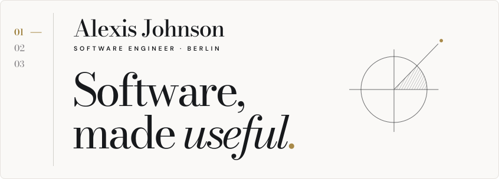
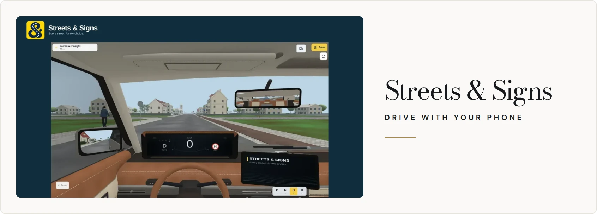
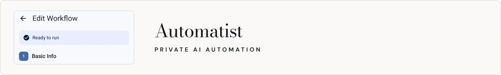

<picture>
  <source media="(max-width: 600px) and (prefers-color-scheme: dark)" srcset="https://raw.githubusercontent.com/atj393/atj393/main/assets/monograph/cover-narrow-dark.svg">
  <source media="(max-width: 600px)" srcset="https://raw.githubusercontent.com/atj393/atj393/main/assets/monograph/cover-narrow-light.svg">
  <source media="(prefers-color-scheme: dark)" srcset="https://raw.githubusercontent.com/atj393/atj393/main/assets/monograph/cover-dark.svg">
  
</picture>

<h3>
<picture>
  <source media="(max-width: 600px) and (prefers-color-scheme: dark)" srcset="https://raw.githubusercontent.com/atj393/atj393/main/assets/monograph/selected-work-narrow-dark.svg">
  <source media="(max-width: 600px)" srcset="https://raw.githubusercontent.com/atj393/atj393/main/assets/monograph/selected-work-narrow-light.svg">
  <source media="(prefers-color-scheme: dark)" srcset="https://raw.githubusercontent.com/atj393/atj393/main/assets/monograph/selected-work-dark.svg">
  
</picture>
</h3>

<a href="https://streetsandsigns.com/">
<picture>
  <source media="(max-width: 600px) and (prefers-color-scheme: dark)" srcset="https://raw.githubusercontent.com/atj393/atj393/main/assets/monograph/streets-and-signs-narrow-dark.webp">
  <source media="(max-width: 600px)" srcset="https://raw.githubusercontent.com/atj393/atj393/main/assets/monograph/streets-and-signs-narrow-light.webp">
  <source media="(prefers-color-scheme: dark)" srcset="https://raw.githubusercontent.com/atj393/atj393/main/assets/monograph/streets-and-signs-dark.webp">
  
</picture>
</a>

**Streets & Signs** · Your phone becomes the steering wheel. Scan a QR code, tilt to steer, and drive a fictional German neighbourhood in the browser. [Play the preview](https://streetsandsigns.com/)

<a href="https://github.com/atj393/automatist-android">
<picture>
  <source media="(max-width: 600px) and (prefers-color-scheme: dark)" srcset="https://raw.githubusercontent.com/atj393/atj393/main/assets/monograph/automatist-narrow-dark.webp">
  <source media="(max-width: 600px)" srcset="https://raw.githubusercontent.com/atj393/atj393/main/assets/monograph/automatist-narrow-light.webp">
  <source media="(prefers-color-scheme: dark)" srcset="https://raw.githubusercontent.com/atj393/atj393/main/assets/monograph/automatist-dark.webp">
  
</picture>
</a>

**Automatist** · Recurring AI tasks on Android, run on cloud, on-device or offline models. No backend, and your keys stay on the phone. [Google Play](https://play.google.com/store/apps/details?id=com.automatist.app) · [Website](https://automatist.cloud/) · [Source](https://github.com/atj393/automatist-android)

<a href="https://github.com/atj393/easy-web-navigation">
<picture>
  <source media="(max-width: 600px) and (prefers-color-scheme: dark)" srcset="https://raw.githubusercontent.com/atj393/atj393/main/assets/monograph/easy-web-navigation-narrow-dark.webp">
  <source media="(max-width: 600px)" srcset="https://raw.githubusercontent.com/atj393/atj393/main/assets/monograph/easy-web-navigation-narrow-light.webp">
  <source media="(prefers-color-scheme: dark)" srcset="https://raw.githubusercontent.com/atj393/atj393/main/assets/monograph/easy-web-navigation-dark.webp">
  
</picture>
</a>

**Easy Web Navigation** · A Chrome extension that draws the path the Tab key takes onto the page, so keyboard problems show up where they happen. [Chrome Web Store](https://chromewebstore.google.com/detail/easy-web-navigation-keybo/jaffeipdpljhnfonacndcpjdkclgjiln) · [Source](https://github.com/atj393/easy-web-navigation)

 

<h3>
<picture>
  <source media="(max-width: 600px) and (prefers-color-scheme: dark)" srcset="https://raw.githubusercontent.com/atj393/atj393/main/assets/monograph/index-narrow-dark.svg">
  <source media="(max-width: 600px)" srcset="https://raw.githubusercontent.com/atj393/atj393/main/assets/monograph/index-narrow-light.svg">
  <source media="(prefers-color-scheme: dark)" srcset="https://raw.githubusercontent.com/atj393/atj393/main/assets/monograph/index-dark.svg">
  
</picture>
</h3>

**[Psalms Way](https://github.com/atj393/psalms-way-app)** · Offline, multilingual reading

**[Re-Phraser](https://github.com/atj393/re-phraser)** · AI rewriting without a backend

**[Urban Ground](https://urban-ground-ten.vercel.app/)** · A strategy game on real maps

**[Prompt Save Reuse](https://github.com/atj393/promt-save-reuse-chatgpt-and-gemini)** · A prompt library across AI tools

**Developer tools** · [Local Browser Automation Bridge](https://github.com/atj393/local-browser-automation-bridge), [design-intelligence](https://github.com/atj393/design-intelligence) and a [Claude Code plugin](https://github.com/atj393/claude-plugin-code-cleanup)

 

From the interface to the system behind&nbsp;it. Product thinking&nbsp;· Full-stack engineering&nbsp;· Applied AI

<picture>
  <source media="(max-width: 600px) and (prefers-color-scheme: dark)" srcset="https://raw.githubusercontent.com/atj393/atj393/main/assets/monograph/rule-narrow-dark.svg">
  <source media="(max-width: 600px)" srcset="https://raw.githubusercontent.com/atj393/atj393/main/assets/monograph/rule-narrow-light.svg">
  <source media="(prefers-color-scheme: dark)" srcset="https://raw.githubusercontent.com/atj393/atj393/main/assets/monograph/rule-dark.svg">
  
</picture>

<a href="https://github.com/atj393">GitHub</a> &nbsp;·&nbsp;
<a href="https://www.linkedin.com/in/atj393/">LinkedIn</a> &nbsp;·&nbsp;
<a href="mailto:alexistoby393@gmail.com">Contact</a>

